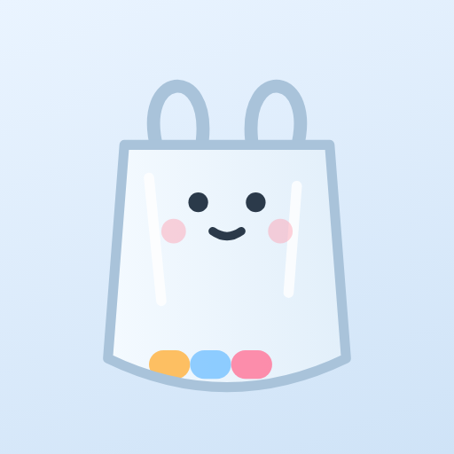
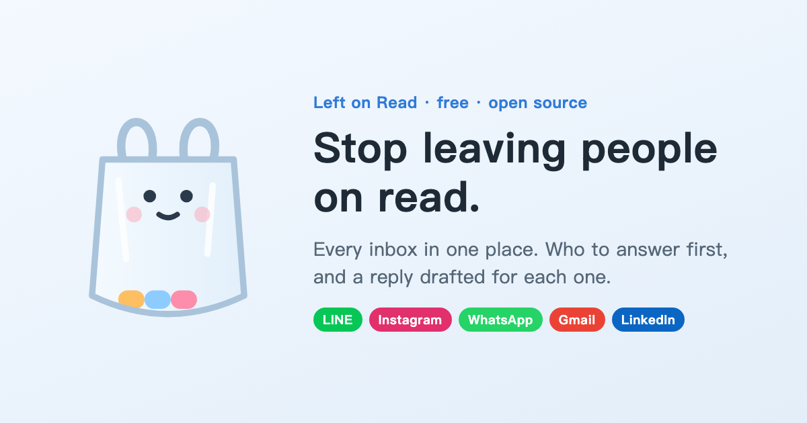

<p align="center">
  
</p>

<h1 align="center">Left on Read · 給塑膠怪</h1>

<p align="center">
  <b>Stop leaving people on read.</b><br>
  Every inbox in one place — who to answer first, and a reply drafted for each one, checked by you before it's sent.
</p>

<p align="center">
  <a href="https://plastic.01-crumbs.workers.dev/en/"><b>Try the demo</b></a> ·
  <a href="https://plastic.01-crumbs.workers.dev/">中文版</a> ·
  <a href="#中文說明">中文說明</a>
</p>

<p align="center">
  
</p>

---

## What it is

A working demo (no sign-up, nothing to install) of a unified inbox for LINE, Instagram, Messenger, WhatsApp, LinkedIn, Gmail and Telegram. Every person, company and message in it is made up.

Its mascot is **Baggy**, a plastic bag. In Taiwanese slang, leaving someone hanging is called *塑膠* ("treating them like plastic"). The more people you leave on read, the heavier Baggy's bag gets. Answer everyone and it floats away.

| | |
|---|---|
| **One inbox** | All conversations together, each avatar marked with its app |
| **Who first** | Ranked by relationship (work > family > friends > groups > strangers), what they want (work > scheduling > questions > small talk > greetings) and any deadline ("reply by Thursday"), then by how long they've waited |
| **Drafts** | Short / warm / formal versions of every reply, editable; answers in the other person's language |
| **Scheduling** | Spots "can we meet?", offers two free slots from your calendar, and holds one when you send |
| **Review first** | Send one at a time, or "Draft them all" → everything waits in Review |
| **Autopilot** | Off / low-risk only (greetings & small talk — never work or strangers) / everything. Per-contact auto-reply too |
| **Cold outreach** | Paste a list + your goal → a personal first message for each → Review |
| **Claude drafts (optional)** | Paste a Claude API key in Settings for live drafts (stored only in your browser). Without one, the demo uses pre-written drafts |
| **English & 中文** | Switch anytime; each language has its own demo inbox |

## The hard part: integrations

| App | Possible? | Notes |
|---|---|---|
| Gmail | ✅ | Gmail API: read, draft, send |
| Telegram | ✅ | Personal-account API (TDLib) |
| Slack | ✅ | Slack API |
| LINE | ⚠️ Official Accounts only | Messaging API; personal LINE has no API |
| Instagram | ⚠️ Professional accounts | Meta Instagram Messaging API |
| Messenger | ⚠️ Pages only | Page inboxes via the Graph API |
| WhatsApp | ⚠️ Business | WhatsApp Business Platform (Cloud API) |
| LinkedIn | ❌ | Messaging API is partner-only |

So the realistic first version is for **creators, small brands and freelancers**, who already use IG professional accounts, LINE Official Accounts, Pages and WhatsApp Business — all officially connectable. Scraping or simulating logins for personal LINE / IG breaks their terms and gets accounts banned.

## Run it locally

Plain HTML + ES modules, no build step:

```bash
cd site && python3 -m http.server 8000
```

Then open <http://localhost:8000/> (中文) or <http://localhost:8000/en/>.

```
site/index.html, site/en/index.html   the page in 中文 / English
site/i18n.js     language: L('中文', 'English') pairs
site/data.js     demo conversations (both languages), app integration notes, fake calendar
site/ai.js       intent, risk, free slots, drafts (templates or Claude), cold outreach
site/app.js      inbox, chat, review, outreach, settings
worker/          cookie-free page-view counter (Cloudflare Workers + D1)
```

## License

[MIT](LICENSE)

---

## 中文說明

**不想再「塑膠」別人？** 給塑膠怪把 LINE、IG、Messenger、WhatsApp、LinkedIn、Gmail 的訊息收在一起，告訴你先回誰，每則都幫你擬好回覆，送出前給你確認。吉祥物「小塑」是一個塑膠袋：你塑膠越多人，袋子越重；全部回完，它就輕飄飄地飛起來。

- **試玩**：<https://plastic.01-crumbs.workers.dev/>（不用註冊；所有人、公司、訊息都是虛構的示範資料）
- **功能**：統一收件匣、依關係／意圖／期限排出先回誰、簡短／溫暖／正式三種草稿、偵測約時間並從行事曆找空檔、送出前確認、自動駕駛、陌生開發
- **Claude 擬稿（選填）**：設定裡貼 Claude API 金鑰（只存在你的瀏覽器）
- **串接的現實**：個人 LINE、LinkedIn 沒有開放 API，所以正式版建議先做「創作者／小品牌／接案者」版
- **中英文**：隨時切換，兩種語言各有一套示範對話

歡迎開 issue 或寫信到 yolanda921223@gmail.com。
